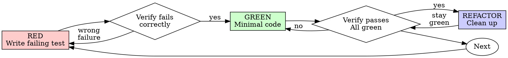

# tdd

Write the test first. Watch it fail. Write minimal code to pass.

**Core principle:** If you didn't watch the test fail, you don't know if it tests the right thing.

**Violating the letter of the rules is violating the spirit of the rules.**

**Announce at start:** "Using tdd to build this test-first."

TDD is the red → green loop. This skill is the reference that makes that loop produce tests worth keeping: what a good test is, where tests go, the anti-patterns, and the rules of the loop. Every section applies on every cycle: consult them before and during the loop, not after.

## The repo's build loop

Read `.agents/build-loop.md` in the repo you are in. Where it names a different loop, it wins: in a repo whose change cycle is not code, the "test" is whatever that file names — a frozen eval case, a run against a surface, a comparison with an expected result — and the red-green cycle is the same cycle over that check.

Where the file gives the test and suite commands, they are the commands below: the single-test run, and the project's suite. `.agents/domain.md`, where the repo has one, is where the vocabulary for test names comes from.

## When to Use

**Always:**

- New features
- Bug fixes
- Refactoring
- Behaviour changes

**Exceptions (ask Ruaridh first):**

- Throwaway prototypes
- Generated code
- Configuration files

Asking is the point: skipping the test-first step needs his say-so, said in this session or per the Inbox convention when he is away, and the exception is recorded where the work is. Thinking "skip TDD just this once"? Stop. That's rationalization.

## The Iron Law

```
NO PRODUCTION CODE WITHOUT A FAILING TEST FIRST
```

Write code before the test? Delete it. Start over.

**No exceptions:**

- Don't keep it as "reference"
- Don't "adapt" it while writing tests
- Don't look at it
- Delete means delete

Implement fresh from tests. Period.

## Red-Green-Refactor



## What a good test is

Tests verify behaviour through public interfaces, not implementation details. Code can change entirely; tests shouldn't. A good test reads like a specification: "user can checkout with valid cart" tells you exactly what capability exists, and it survives refactors because it doesn't care about internal structure.

See `references/tests.md` for examples and `references/mocking.md` for mocking guidelines. `references/writing-good-tests.md` is the long form: the two principles (every test names the break it catches, every test exercises the real thing), the gate functions to run before writing a test body and before adding a mock, and the mutation check to run before finishing.

## Seams: where tests go

A **seam** is the public boundary you test at: the interface where you observe behaviour without reaching inside. Tests live at seams, never against internals.

**Test only at pre-agreed seams.** Before writing any test, write down the seams under test and confirm them: the plan or brief already named them when it named the files and tests, and a seam the plan left open is confirmed with Ruaridh (per the Inbox convention when he is away). No test is written at an unconfirmed seam. You can't test everything, so agreeing the seams up front is how testing effort lands on the critical paths and complex logic instead of every edge case.

Ask: "What's the public interface, and which seams should we test?" **Give each proposed seam a one-line note on what it catches and what it misses.** A seam that catches the wrong calls but not the ordering, or catches the happy path but not the retry, is a seam with a known blind spot, and the note is what stops the next person trusting it for the wrong thing.

When the shape of that interface is itself in question (how deep the module is, where the seam belongs, what the interface should expose), `arch` is the vocabulary: module, interface, depth, seam, adapter, leverage, locality. It is a reference to consult, not a session to run.

## RED - Write Failing Test

Write one minimal test showing what should happen.

<Good>
```typescript
test('retries failed operations 3 times', async () => {
  let attempts = 0;
  const operation = () => {
    attempts++;
    if (attempts < 3) throw new Error('fail');
    return 'success';
  };

  const result = await retryOperation(operation);

  expect(result).toBe('success');
  expect(attempts).toBe(3);
});
```
Clear name, tests real behavior, one thing
</Good>

<Bad>
```typescript
test('retry works', async () => {
  const mock = jest.fn()
    .mockRejectedValueOnce(new Error())
    .mockRejectedValueOnce(new Error())
    .mockResolvedValueOnce('success');
  await retryOperation(mock);
  expect(mock).toHaveBeenCalledTimes(3);
});
```
Vague name, tests mock not code
</Bad>

**Requirements:**

- One behaviour
- Clear name
- Real code (no mocks unless unavoidable)

## Verify RED - Watch It Fail

**MANDATORY. Never skip.**

```bash
npm test path/to/test.test.ts
```

Confirm:

- Test fails (not errors)
- Failure message is expected
- Fails because feature missing (not typos)

**Test passes?** You're testing existing behaviour. Fix test.

**Test errors?** Fix error, re-run until it fails correctly.

## GREEN - Minimal Code

Write simplest code to pass the test.

<Good>
```typescript
async function retryOperation<T>(fn: () => Promise<T>): Promise<T> {
  for (let i = 0; i < 3; i++) {
    try {
      return await fn();
    } catch (e) {
      if (i == 2) throw e;
    }
  }
  throw new Error('unreachable');
}
```
Just enough to pass
</Good>

<Bad>
```typescript
async function retryOperation<T>(
  fn: () => Promise<T>,
  options?: {
    maxRetries?: number;
    backoff?: 'linear' | 'exponential';
    onRetry?: (attempt: number) => void;
  }
): Promise<T> {
  // YAGNI
}
```
Over-engineered
</Bad>

Don't add features, refactor other code, or "improve" beyond the test.

## Verify GREEN - Watch It Pass

**MANDATORY.**

```bash
npm test path/to/test.test.ts
```

Confirm:

- Test passes
- Other tests still pass
- Output pristine (no errors, warnings)

**Test fails?** Fix code, not test.

**Other tests fail?** Fix now.

**"Other tests" means the project's suite, not just your file.** A
green run of the test you wrote is not a green suite. Before you call
the change done, run the project's test command (bare `pytest`,
`npm test`, `cargo test` — whatever the repo uses) even when your task
named only one test file. A scope statement in your task bounds the
deliverable, not your verification. Any failure that run shows —
including one you didn't cause — goes in your report by name; a red
test you watched scroll past and didn't mention is a report falsified
by omission.

## REFACTOR - Clean Up

After green only:

- Remove duplication
- Improve names
- Extract helpers

Keep tests green. Don't add behaviour. Refactoring here is the cycle's own small step, not a licence to restructure the module: the whole-branch pass is `review`'s.

## Repeat

Next failing test for next feature.

## Anti-patterns

- **Implementation-coupled**: mocks internal collaborators, tests private methods, or verifies through a side channel (querying the database instead of using the interface). The tell: the test breaks when you refactor but behaviour hasn't changed.
- **Tautological**: the assertion recomputes the expected value the way the code does (`expect(add(a, b)).toBe(a + b)`, a snapshot derived by hand the same way, a constant asserted equal to itself), so it passes by construction and can never disagree with the code. Expected values must come from an independent source of truth: a known-good literal, a worked example, the spec.
- **Horizontal slicing**: writing all tests first, then all implementation. Bulk tests verify _imagined_ behaviour: you test the _shape_ of things rather than user-facing behaviour, the tests go insensitive to real changes, and you commit to test structure before understanding the implementation. Work in **vertical slices** instead: one test → one implementation → repeat, each test a **tracer bullet** that responds to what the last cycle taught you.

## Rules of the loop

- **Red before green.** Write the failing test first, then only enough code to pass it. Don't anticipate future tests or add speculative features.
- **One slice at a time.** One seam, one test, one minimal implementation per cycle.
- **Refactor after green only**, in the cycle's small step; a restructure of the module is a different ticket through `review`.

## Good Tests

| Quality | Good | Bad |
|---------|------|-----|
| **Minimal** | One thing. "and" in name? Split it. | `test('validates email and domain and whitespace')` |
| **Clear** | Name describes behavior | `test('test1')` |
| **Shows intent** | Demonstrates desired API | Obscures what code should do |

When writing or changing any test, read `references/writing-good-tests.md` for the rules that keep tests honest:

- Name the production change that would make the test fail — before writing it
- Assert on real behaviour, never on mock behaviour
- Keep test-only code in test utilities, out of production classes
- Understand a dependency's side effects before mocking it

## A bug, test-first

When a bug has a clear, cheap test path, make the broken behaviour executable before changing production code. The goal is a focused regression test that fails before the fix and passes after it. This is also `debug`'s Phase 5, which is where a debug run reaches for this skill.

Do not force a test when it would be impractical. If the available test would require broad harness setup, brittle mocks, slow end-to-end infrastructure, production-only state, vague reproduction steps, or large unrelated fixture churn, skip adding a new test and use the closest useful verification instead.

1. **Understand the bug.** Identify the intended behaviour, current behaviour, affected path, and smallest observable reproduction.
2. **Choose the narrowest executable check.** Prefer the closest unit, component, integration, or regression test already used for that codepath. If no practical test path is obvious, do not create one from scratch just to satisfy the workflow.
3. **Write the failing test first.** Add the smallest focused test that would have caught the bug. The test should encode intended behaviour, not mirror the current implementation.
4. **Run the new test before fixing.** Confirm it fails for the intended reason. If it passes or fails for an unrelated reason, correct the test or reproduction before editing the implementation.
5. **Fix the bug.** Make the smallest production change that satisfies the intended behaviour while preserving nearby contracts.
6. **Rerun the regression test.** Confirm the test now passes.

Commit the failing repro and the fix as two commits, in that order (`debug`'s default loop).

### If a Failing Test Is Impractical

Use the closest executable regression check instead: a targeted script, manual reproduction command, browser automation, snapshot comparison, log assertion, or focused integration check.

Prefer no new test over a bad test. A bad test is one that mostly tests mocks, encodes current implementation details, depends on timing or unrelated global state, needs expensive infrastructure for a small fix, or would be deleted immediately after proving the fix.

### Guardrails

- Do not change tests merely to match a wrong implementation.
- Do not weaken existing assertions unless the expected behaviour has genuinely changed and the reason is clear.
- Keep the regression test focused on the bug. Avoid broad fixture churn or unrelated coverage expansion.
- If the bug is flaky, make the test deterministic where possible and document the signal being locked down.
- If the bug exposes a broader class of failures, first land the focused regression path, then consider additional sibling coverage.

### Report the evidence

- Name the failing-before test or executable check and the failure it produced.
- Name the passing-after test run and any nearby validation performed.
- If failing-before evidence could not be demonstrated, state why and describe the closest regression check used instead.

## Common Rationalizations

| Excuse | Reality |
|--------|---------|
| "Too simple to test" | Simple code breaks. Test takes 30 seconds. |
| "I'll test after" | Tests written after pass immediately — which proves nothing. They may test the wrong thing, test the implementation instead of the behavior, or miss the edge case you forgot. You never watched it fail, so you never proved it can catch the bug. Test-first forces that failure. |
| "Tests after achieve same goals (spirit not ritual)" | Tests-after answer "what does this do?"; tests-first answer "what should this do?" Tests written after are biased by the code you already wrote — you verify the cases you remembered, not the ones you'd have discovered. Coverage without proof the tests work. |
| "Already manually tested" | Manual testing is ad-hoc: no record of what you covered, no way to re-run it when the code changes, easy to forget cases under pressure. "Worked when I tried it" ≠ comprehensive. Automated tests run the same way every time. |
| "Deleting X hours is wasteful" | Sunk cost fallacy — that time is already spent either way. The real choice: rewrite with TDD (high confidence) vs. keep it and bolt tests on after (low confidence, likely bugs). Keeping code you can't trust is the waste. |
| "Keep as reference, write tests first" | You'll adapt it. That's testing after. Delete means delete. |
| "Need to explore first" | Fine. Throw away exploration, start with TDD. |
| "Test hard = design unclear" | Listen to test. Hard to test = hard to use. |
| "TDD will slow me down" | TDD IS the pragmatic path: catches bugs before commit, prevents regressions, lets you refactor without fear. "Pragmatic" shortcuts mean debugging in production — slower, not faster. |
| "Manual test faster" | Manual doesn't prove edge cases. You'll re-test every change. |
| "Existing code has no tests" | You're improving it. Add tests for existing code. |

## Red Flags - STOP and Start Over

- Code before test
- Test after implementation
- Test passes immediately
- Can't explain why test failed
- Tests added "later"
- Rationalizing "just this once"
- "I already manually tested it"
- "Tests after achieve the same purpose"
- "It's about spirit not ritual"
- "Keep as reference" or "adapt existing code"
- "Already spent X hours, deleting is wasteful"
- "TDD is dogmatic, I'm being pragmatic"
- "This is different because..."

**All of these mean: Delete code. Start over with TDD.**

## Example: Bug Fix

**Bug:** Empty email accepted

**RED**
```typescript
test('rejects empty email', async () => {
  const result = await submitForm({ email: '' });
  expect(result.error).toBe('Email required');
});
```

**Verify RED**
```bash
$ npm test
FAIL: expected 'Email required', got undefined
```

**GREEN**
```typescript
function submitForm(data: FormData) {
  if (!data.email?.trim()) {
    return { error: 'Email required' };
  }
  // ...
}
```

**Verify GREEN**
```bash
$ npm test
PASS
```

**REFACTOR**
Extract validation for multiple fields if needed.

## Verification Checklist

Before marking work complete:

- [ ] Every new function/method has a test
- [ ] Watched each test fail before implementing
- [ ] Each test failed for expected reason (feature missing, not typo)
- [ ] Wrote minimal code to pass each test
- [ ] All tests pass
- [ ] Output pristine (no errors, warnings)
- [ ] Tests use real code (mocks only if unavoidable)
- [ ] Edge cases and errors covered
- [ ] Every seam under test has its note: what it catches, what it misses

Can't check all boxes? You skipped TDD. Start over.

## When Stuck

| Problem | Solution |
|---------|----------|
| Don't know how to test | Write wished-for API. Write assertion first. Ask Ruaridh (per the Inbox convention when he is away). |
| Test too complicated | Design too complicated. Simplify interface. |
| Must mock everything | Code too coupled. Use dependency injection. |
| Test setup huge | Extract helpers. Still complex? Simplify design. |

## Debugging Integration

Bug found? Write failing test reproducing it. Follow TDD cycle. Test proves fix and prevents regression.

Never fix bugs without a test, and route the investigation through `debug` when the cause is not obvious.

## Final Rule

```
Production code → test exists and failed first
Otherwise → not TDD
```

No exceptions without Ruaridh's permission.
