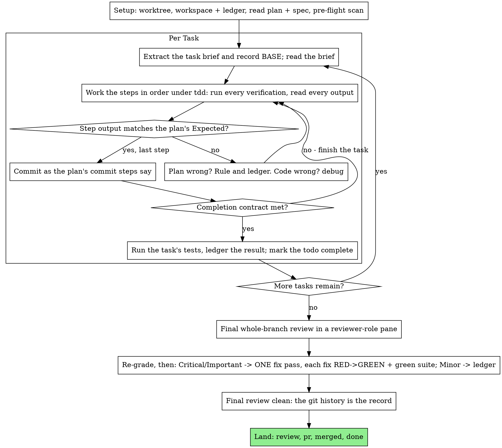
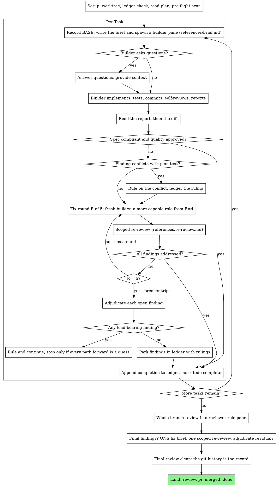

# implement

Execute a plan, ticket by ticket: fetch the ticket, cut a worktree, run the plan's tasks or derive them from the ticket, prove each step with a test you watched fail and then pass, and leave a record that survives your own forgetting.

The ticket is the contract, the spec is the authority behind it, the plan is its argument.

Repo specifics come from `.agents/`: `tracker.md` for the ticket and its states, `build-loop.md` for the step list (default: failing test → run → implement → run → commit), `prove-landed.md` for proof, `references.md` for the must-read references by surface (match the files the task touches against its path patterns and read the named references before the first edit), `review.md` for the per-surface checks `review` runs, and `design-review.md` and `deploy.md` when they exist. A missing file means this skill's default.

## The decision trail

Every run of this skill keeps a decision trail, inline or delegated: the record of what you decided on Ruaridh's behalf, written as you go. It exists because the ledger and the plan's workspace are the plan's memory and die with it, while the trail belongs to the ticket and outlives every session that touches it.

- **Where it goes:** `.scratch/decisions/<ticket>.tsv`, appended with `<skills dir>/verify/scripts/log.sh` (the script's usage line is the argument order). It is uncommitted scratch: a resumed session, a fix round and a later ticket in the same stack read it, and nothing commits it. `verify` owns the trail, its rows and what each phase means.
- **What goes in it:** every decision, logged when you make it, not reconstructed afterwards. Inline mode's `Ruling:` lines, delegated mode's rulings on plan conflicts and builder findings, parked findings and breaker adjudications, review re-grades, deferred minors you decide not to act on, and the stop when you stop. In delegated mode the builders never see the trail: you log what their reports and the reviews lead you to decide.
- **When it is posted:** at the end of the run, and at any pause before `handoff`, one comment on the ticket carries the trail, in the format `<skills dir>/verify/references/decision-trail.md` gives, posted through the tracker in `.agents/tracker.md`. One comment per run or pause, not one per decision.

## Two ways to run a plan

**Inline:** execute the plan yourself, task by task, in this session: no builder pane per task, no reviewer per task. One fresh-context review of the whole branch at the end.

**Delegated:** spawn a fresh builder pane per task in its own worktree, have each task's work reviewed as part of its phase, and run a broad whole-branch review at the end.

**Why inline:** a fresh builder and a fresh reviewer per task means each re-reads the codebase from zero. Inline execution pays for one context (yours) plus one review at the end. What it gives up is a fresh context per task and a second pair of eyes per task. This mode keeps what those two things bought, by other means: the brief is the spec, the ledger is your memory, `tdd` is the per-task gate, and the final reviewer is the second pair of eyes.

**Why builders:** you delegate tasks to builder panes with isolated context. By precisely crafting their instructions and context, you ensure they stay focused and succeed at their task. They never inherit your session's context or history — you construct exactly what they need. This also preserves your own context for coordination work.

**Core principle, delegated:** fresh builder per task + review of each integrated phase + broad final review = high quality, fast iteration.

**Delegated vs inline:**

- Fresh builder per task (no context pollution) instead of one context doing every task
- Review of the integrated phase (spec compliance + code quality) instead of only at the end
- Costs a fresh context per task and per review; inline costs one context plus one final reviewer
- Both run in this session, share the same plan workspace and ledger, and never pause between tasks

The workspace and ledger are shared by both modes, so a plan can change executors mid-flight and the new one resumes from the same ledger.

**Narration:** between tool calls, narrate at most one short line — the ledger and the tool results carry the record.

**Continuous execution:** do not pause to check in with Ruaridh between tasks. He chose the mode to get the plan executed, not to answer "should I continue?" after every task. Execute all tasks from the plan without stopping.

**Rulings, not stalls.** A running plan does not wait on a human. Conflicts, ambiguities, plan defects, a cap you would have asked to exceed — decide them. The spec is the binding authority, the plan is its argument, and your judgment settles what neither answers. Record every decision in the ledger as `Ruling: <what you decided> — <why> — <what it costs if wrong>`, and keep going. A wrong ruling costs rework Ruaridh can see and undo; a session parked on a question costs him the whole run and buys nothing. Deviating from the plan without a ledgered ruling is a decision made in secret.

Four things stop you, and only these: an irreversible or destructive operation; a security-sensitive action; a side effect outside this worktree that norms say you ask about first (a merge, a push to a shared branch, a publish); and a plan so broken that every path forward is a guess. For those, stop and ask: in chat when he is here, otherwise ask per the Inbox convention.

## Start

1. **Fetch the ticket** per `.agents/tracker.md` and state its title before starting. If the reference is ambiguous, ask. Read its parent spec and its comments. A handoff summary in `.herdr-handoffs/` or a ticket with `work.branch` set is a pickup: run `handoff` (pickup) first.
2. **Worktree before the first edit**: `.worktrees/<ticket-ref>-<slug>`, branch of the same name, cut from the freshly fetched remote default branch. Base it on the previous ticket's branch instead when that PR is the real latest base, still awaiting Ruaridh's merge (the stack). Set `work.branch` on the ticket.
3. **Mode**: whatever Ruaridh picked at the end of `to-plan`. A single small ticket with no plan runs inline. Several refs or "a wave" run delegated.

## Setup, both modes

Never start implementation on a main/master branch without Ruaridh's explicit consent.

Conversation memory does not survive compaction. A session that loses its place re-implements tasks whose commits already exist — the same failure as a coordinator re-spawning them, paid for in your own context. Track progress in a ledger file, not only in todos. Harness todos are a live view; the ledger is the record. The commits the ledger names exist in git even when your context no longer remembers making them: after compaction, trust the ledger and `git log` over your own recollection.

- **The plan's workspace** is `.scratch/plans/<plan-basename>/`, git-ignored, and home to every artifact for THIS plan: task briefs, builder reports, review packages, test logs. Another plan's directory is never yours to read or write. A stray ledger elsewhere is another plan's progress: leave it in place and start your own, fresh.
- **The ledger** is `.scratch/plans/<plan-basename>/progress.md`; its shape is in `references/ledger.md`. If its first line names your plan file, tasks with a `Task <N>: complete` line are DONE — do not redo them; resume at the first task without one. A task whose last line is a fix round is mid-loop: resume the loop at the next round. A ledger whose first line names a different plan file is not yours.
- **Create the ledger** with its identity as the first line: `# Ledger — plan: <plan file path>`.
- `git clean -fdx` destroys the workspace (it is git-ignored scratch); if that happens, recover from `git log`.
- **Read the plan once**: its context, Global Constraints and Review focus, and create a todo per task. If the plan names a spec, read that too — the spec is the authority the plan argues from, and conflicts inside the plan resolve against it. A plan with no reachable spec gets a ledger note saying so; rulings made without one are provisional.
- **Pre-flight scan**, before Task 1, writing down what you checked as you check it: tasks that contradict each other or the plan's Global Constraints, and anything the plan explicitly mandates that the review treats as a defect (a test that asserts nothing, verbatim duplication of a logic block). The plan's Interfaces blocks tell you where to look. The scan's output is a table, not a verdict: one row for every pair of tasks that share a file or an interface — the two tasks, what one produces against what the other consumes, and what you found — and one row for every task: whether its own text agrees with itself, the tests it specifies against the code it specifies, the files it creates against the files it later touches. "The scan is clean" without those rows is not a scan you ran. Write the table to the ledger. A plan whose tasks share nothing gets the single line `Pre-flight: no shared interfaces`.
- **Rule on everything the scan finds** before execution begins — each finding against the plan text that mandates it — and record each ruling beside its row. If the scan is clean, proceed without comment. The review loop remains the net for conflicts that only emerge from implementation.
- **Load `tdd` now**, before Task 1: it governs every step of every task below, and a plan whose steps already say "write the failing test first" does not exempt you from it.

## Inline mode

Inline is right when the tasks are mostly independent (the same precondition as delegated mode) and Ruaridh chose it at the handoff. Prefer delegated mode when he wants a review gate on each phase, or when the plan is long enough that its later tasks would run on a compacted context; inline execution over a long plan still works — the ledger is what makes it recoverable — but the last tasks get the least of you. A fully specified plan makes inline execution transcription plus testing, so it runs well on a mid-tier role, and the one place the most capable role earns its cost is the final review, which this mode runs separately. Say so when he chooses inline. With no Herdr pane available (`HERDR_ENV` unset), never fabricate a dispatch: run the plan here.



Everything you print, and every tool result, stays resident in your context for the rest of the session. Redirect long test output to a file in the workspace and read its tail; read a brief, not the whole plan.

### 1. Take the task

Extract the task's full text from the plan into `.scratch/plans/<plan-basename>/task-<N>-brief.md` in one step, and record BASE (`git rev-parse HEAD`), the commit the task's range is cut from. Read the brief for every task, including ones you remember from setup: what you remember is a summary, the brief has the exact values, signatures and test cases. Mark the task's todo in_progress.

Every tool call is a turn that re-reads your whole context. Bookkeeping rides along with work — a ledger append in the same call as the commit, never in a call of its own.

### 2. Work the steps

The plan's steps are already in RED-GREEN order; follow them in that order under `tdd`, loaded at setup. A test step's code is written first and run first. Watching it fail is a step, not a formality — a test that passes before the implementation exists is a finding about the test.

Every step that runs a command has an `Expected:` line. Run the command, read its output, and compare. Three outcomes:

- **Matches.** Next step.
- **The code is wrong.** Use `debug`. Find the cause; never patch the symptom to make the step's output match.
- **The plan is wrong** — a step contradicts the spec, an interface from an earlier task doesn't match what this task consumes, a command that cannot work. Rule on the smallest change that satisfies the spec, ledger it as `Task <N>: Ruling: <finding> — <what you decided and why>`, and continue. The ruling is carried, not remembered: later tasks that touch the same interface read it from the ledger.

Commit as the plan's commit steps say: gitmoji, imperative subject, a one-line why in the body, explicit paths staged. A task that spans several commits is fine; BASE is what the review range is cut from, never `HEAD~1`.

### 3. The completion contract

Before a task's ledger line, all of the following are true, with evidence in this session — not inferred from the diff looking right:

- Every test the brief names exists and ran in this task, and you read the output.
- The final test run for the task passed, and its command and result are in the ledger line.
- Every `Expected:` line in the brief was compared against real output.
- Every deviation from the brief has a `Ruling:` line in the ledger.

`verify` governs the claim. If any item is missing, the task is not complete: finish it.

### 4. Complete the task

Run the test command the brief names for the whole task, keep the full output in the workspace, read the tail, and — only if it passes — append the completion line to the ledger:

`Task <N>: complete (commits <base7>..<head7>, tests: <command> → <result>)`

A failing run records nothing; the task is not complete. When it records, mark the todo complete and take the next task.

### Final review, inline

Build a review package at `.scratch/plans/<plan-basename>/review-<base7>..<head7>.diff`: the branch's commit list, a stat summary, and the full diff with extended context (`-U10`), cut from the commit the branch started from (`git merge-base <default> HEAD`), never from `HEAD~1`, which silently truncates a multi-commit task. Guard the range: HEAD must be a descendant of the base and the range must not be empty, or the package is bogus.

Spawn the reviewer role in a Herdr pane (`herdr`) against that package, with the plan and spec paths, the plan's Review focus section verbatim (the input classes and failure modes the plan's tests do not exercise — the reviewer checks each deliberately), and a pointer to the ledger's `Ruling:` lines so it can weigh the calls you made. This is the one fresh context the run buys: do not skip it, and do not replace it with your own read of the diff. If no pane can be spawned at all, perform that review yourself against the package as a separate pass after the last task's ledger line, write `Final review: self-review (no pane)` to the ledger, and say so plainly: a self-review by the author is weaker than a fresh reviewer, and Ruaridh decides whether that is enough before merge.

Sort the findings before you act on any of them. The reviewer's severity labels are advice; the gate is yours. Its "Declined to judge" list is yours too: every line there is a ruling you make and ledger, exactly like a plan conflict — `Final: Ruling: <behavior the reviewer set aside> — <what a reasonable person using this software gets, and why that stands or why it is now a finding> — <cost if wrong>`. Re-grade first, by effect: the spec is a vision document, and a finding's grade is what a reasonable person using this software gets if it ships, not whether the spec names the input that triggers it — a reviewer who set a finding at Minor because the spec was silent has graded the spec, not the effect. Then:

- **Critical and Important** enter the fix pass.
- **Minor** goes to the ledger as `Final: minor (deferred): <one-liner>` and to your final message under "Deferred minors". Minors never enter the fix pass, and never become rulings — a ruling is a decision about a conflict, not a note that you declined a polish suggestion.

Fix the Critical and Important findings yourself — you are the implementer here — in ONE pass. Each fix is verified by `tdd`, not by a second reviewer: write the test that reproduces the finding, watch it fail, make it pass, then run the whole suite. Record each in the ledger as `Final: fixed <finding> — <test name> RED→GREEN, suite <N>/<N>`. A fix without a test that failed first is not verified; a suite that is not green after the pass means the pass is not over. Do not run a re-review: it would re-read a diff whose covering tests already answer "addressed" and whose suite run already answers "broke nothing".

A finding you decide not to fix is a ruling — `Final: Ruling: <finding> — <why the code stands> — <cost if wrong>` — and reaches Ruaridh in the rulings list. There is no second fix pass.

## Delegated mode

You own the design and the integration. You do not write the code: you author briefs, drain completions, review every diff, and decide. A change the coordinator makes to a builder's code skips review, so changes are tasks like any other, with a brief.

### The split

Before the first spawn, write the throughput checkpoint to the ledger as four items. A dimension that genuinely does not apply (single file, no fan-out) keeps its item with `n/a: <reason>` rather than being dropped:

- **Blocking first steps.** Gates run before fan-out.
- **Independent workstreams.** Disjoint files, services or layers parallelize. Shared writes serialize.
- **Shared mutable state.** Default to splitting the target rather than serializing on it; serialize only for a real invariant.
- **Smallest safe decomposition.** If one builder is best, name why.

Code-coupled work (one feature, one migration) goes to a single owner with the checkpoint inline; that owner fans out internally after the blocking phase. Parent-level fan-out is for slices that produce independent artifacts (audits, cross-subsystem investigations, competing experiments). Rewrite the checkpoint at phase boundaries. Spawn a fresh owner rather than chaining interrupts.

Assign one workstream, worktree and branch per builder; several builders may feed one PR. Put shared contracts before parallel policies and a risky integration switch last. One writer per worktree or branch. Each phase PR bases on the previous one (`pr`).

**Batch small same-shape work.** When the plan lists several tasks that are each a small, independent edit of the same kind — the same one-line fix, constant change or field addition repeated across files — do not spawn one builder per task. Compose ONE brief listing every file and its change, send the whole batch to a single builder, and review its diff as one unit. Reserve one brief per task for work that needs its own judgment, its own tests, or its own review surface.

### The task loop



**Waiting on builders:** a spawn's brief already ends with the instruction to notify your pane (`(aimsg) DONE <name> <summary path>`), so wait for that prompt rather than polling a summary file or a status. Never poll with short timeouts, and never sit in one silent, open-ended wait either. While you have local work — ledger updates, packaging the next review, reading reports — keep working; completions arrive on their own. When you are genuinely idle, wait in bounded stretches and between stretches run `panes.py list` to reconcile your live panes, chasing any that finished without a notice. A resume restarts an idle pane, so never resume one to check on it: probe read-only.

### 1. Dispatch the builder

Record BASE (`git rev-parse HEAD`) before spawning — the review package and fix-round diffs need it.

- **The brief is the product.** A vague brief fails quietly, because a worker cannot ask you a question it does not know it has. Every spawn carries all of `references/brief.md`; a field you cannot fill is a unit you have not scoped yet, and a missing field is a refuse-to-spawn condition. Collapse it to a paragraph for a one-command unit, keeping goal, scope, verify and report.
- **The brief stays the single source of requirements.** Extract the plan's task text to `.scratch/plans/<plan-basename>/task-<N>-brief.md` and have the dispatch introduce it as "read this first — it is your requirements, with the exact values to use verbatim". Exact values (numbers, magic strings, signatures, test cases) appear only in the brief. Never make a builder read the whole plan file.
- **The dispatch** adds only what the brief cannot know: one line on where this task fits in the project; interfaces and decisions from earlier tasks; your resolution of any ambiguity you noticed; if an earlier task parked a finding in the area this task touches, a pointer to that ledger entry; and the report-file path. It carries the standing instructions in `references/builder.md` by absolute path, since a `--lean` worker has no skills index to discover anything from.
- **A dependency is a context relay, not just ordering.** Upstream reports are pasted in full when this unit depends on them, because workers cannot see siblings. Undeclared upstream context makes the builder guess.
- **Never paste accumulated history.** A dispatch describes one task, not the session's: a real dispatch reached 42k characters of which 99% was pasted prior-task summaries. A fresh builder needs its task, the interfaces it touches, and the global constraints. Nothing else.
- **The no-panes contract** is in `references/builder.md`: the builder does all of the task's work itself, never spawns a helper, and above all never spawns its own reviewer. A worker-spawned reviewer duplicates the gate you are about to run, at full cost, and its approval counts for nothing.
- **Spawn** with `herdr`: `--task-file`, `--no-wait`, `--lean`, worker mode by default, and the builder role's model from `~/.config/agents/models.toml`. Never clone your own model by habit. Record the pane's name and session id (`herdr` keeps both in its pane ledger) — a fix round needs the pane to find the report file, and the pane list to reconcile completions.
- **Never spawn two implementation panes in parallel on the same files** (conflicts). Parallel is for disjoint domains.

### 2. Handle the report

A builder reports one of four statuses. Handle each appropriately:

**DONE:** build the review package (`references/review.md` has the recipe and the range guards) from the BASE you recorded — never `HEAD~1`, which silently drops all but the last commit of a multi-commit task — then open the review.

**DONE_WITH_CONCERNS:** the builder completed the work but flagged doubts. Read the concerns before proceeding. If they are about correctness or scope, address them before review. If they are observations (e.g. "this file is getting large"), note them and proceed to review.

**NEEDS_CONTEXT:** the builder needs information that wasn't provided. Provide the missing context and spawn again.

**BLOCKED:** the builder cannot complete the task. Assess the blocker:

1. If it's a context problem, provide more context and re-spawn with the same role
2. If the task requires more reasoning, re-spawn with a more capable role
3. If the task is too large, break it into smaller pieces
4. If the plan itself is wrong, rule on the correction, ledger it, and re-spawn with the ruling carried in the dispatch

**Never** ignore an escalation or force the same role to retry without changes. If the builder said it is stuck, something needs to change. If it asks questions — before starting or mid-task — answer clearly and completely, and do not rush it into implementation.

### 3. Review the task or phase

A review gate runs per integrated phase (Ruaridh's decision), on the phase's combined diff, not one gate per task: a per-task reviewer duplicates the phase review and multiplies its cost by the task count. Never accept a report without both verdicts — spec compliance AND code quality. A builder's self-review never replaces the gate; both are needed.

- **Hand the reviewer its diff as a file**, not as text in the prompt: the package never enters your own context, and the reviewer sees the commit list, stat summary and full diff with context in one read. `references/review.md` is the reviewer's prompt; spawn it in a `reviewer`-role pane, read-only.
- **Reviewer inputs:** the diff file, the brief, the report file, and the global constraints that bind the task.
- The **global-constraints block** you hand the reviewer is its attention lens. Copy the binding requirements verbatim from the plan's Global Constraints section or the spec: exact values, exact formats, and the stated relationships between components ("same layout as X", "matches Y"). The reviewer's template already carries the process rules (YAGNI, test hygiene, review method) — the constraints block is for what THIS project's spec demands.
- Do not add open-ended directives like "check all uses" or "run race tests if useful" without a concrete, task-specific reason.
- Do not ask a reviewer to re-run tests the builder already ran on the same code — the report carries the test evidence.
- Do not pre-judge findings. Never instruct a reviewer to ignore or not flag a specific issue. If you believe a finding would be a false positive, let the reviewer raise it and adjudicate it in the loop. If the prompt you are writing contains "do not flag", "don't treat X as a defect", "at most Minor" or "the plan chose" — stop: you are pre-judging, usually to spare yourself a review loop.

The reviewer may report "cannot verify from diff" items — requirements that live in unchanged code or span tasks. These do not block the rest of the review, but you resolve each one yourself before marking the work complete: you hold the plan and the cross-task context the reviewer lacks. If you confirm an item is a real gap, treat it as a failed spec review — it enters the fix loop with the other findings.

### 4. The fix loop

The loop triggers when the review reports spec ❌, any Critical or Important finding, or a "cannot verify" item you confirmed as a real gap.

Before the loop starts, two routes leave it immediately:

- Record Minor findings in the ledger as you go (`Task <N>: minor (deferred): <one-liner>`), and point the final whole-branch review at that list so it can triage which must be fixed before merge. A roll-up nobody reads is a silent discard. Minor findings never enter the loop.
- A finding labeled plan-mandated — or any finding that conflicts with what the plan's text requires — is yours to rule on: weigh the finding against the plan text, decide with the spec as the binding authority, and ledger the ruling before you act on it. Do not dismiss the finding because the plan mandates it, and do not dispatch a fix that contradicts the plan without a recorded ruling.

Everything else enters the loop. A fix round is one fix brief plus one scoped re-review. Five rounds maximum:

**Every round, a fresh builder with consolidated scope.** Fresh is the default for a fix round: the brief, the report-file path, the open findings verbatim, and — from round 4 — a framing that says a prior builder attempted this task [N] times and owns it now, with the report file for what was tried, on a more capable role. A loop that survives three rounds usually means the builder cannot see its own problem; fresh eyes and a capability bump in one move. Resume the original pane only when the fix strictly needs state that lives in it — its uncommitted work, its running process — and never chain resumes on a muddled brief, which silently drops directives. The report file is the persistent memory either way.

**Every round, either way:** the builder fixes, re-runs the tests covering the amended code, appends its fix report to the same report file, and returns the short status contract. Before re-dispatching the reviewer, confirm the fix report contains the covering tests, the command run, and the output; dispatch the re-review once all three are present. Name the covering test files in the fix brief — a one-line fix does not need the whole suite.

**The re-review is scoped.** Cut the package from the head the previous review saw, and spawn `references/re-review.md` with the findings list, the brief, the report file and the diff path. The re-reviewer verdicts each finding ADDRESSED or NOT ADDRESSED and flags new breakage in the fix diff only. New Critical/Important breakage in the fix diff joins the open findings list. Out-of-scope observations go to the ledger as deferred minors — they never extend the loop.

**After each round,** append to the ledger:
`Task <N>: fix round <R>/5 (<X> addressed, <Y> open — <finding one-liners>; commits <a7>..<b7>)`

**The breaker.** When round 5's re-review still leaves findings open, stop spawning. Adjudicate each open finding yourself — you hold the plan and the cross-task context the reviewer lacks:

- **The reviewer is wrong, or the point is contestable:** park it — `Task <N>: parked — <finding> — Ruling: <why the code stands>`. The final review sees both sides.
- **Real, but nothing downstream builds on it:** park it the same way, with a ruling that says it is real and deferred.
- **Real and load-bearing** — a later task builds on it, or it reveals a plan defect: rule on the smallest change that unblocks the dependent work, ledger it as `Task <N>: Ruling: <finding> — <what you decided and why>`, and carry it into the next task's brief. Parking a structural failure silently lets every dependent task build on it. Stop only when the defect leaves every path forward a guess.

Adjudicate only at the cap. Adjudicating earlier to end a loop is pre-judging with a different name. Every adjudication is a ledger entry — a silent discard is forbidden.

### 5. Complete the task

When the review comes back clean — or every open finding is parked with a ruling at the cap — append the completion line to the ledger in the same message as your other bookkeeping:

- `Task <N>: complete (commits <base7>..<head7>, review clean)`
- `Task <N>: complete (commits <base7>..<head7>, <K> parked)` after a tripped breaker

Then mark the todo complete and move on. Never move to the next task while the review has open Critical/Important issues that are neither fixed nor parked-with-ruling at the cap.

### Model selection

Read the roles from `~/.config/agents/models.toml` and pass the role's exact id; never hard-code a model in a brief. Use the least capable role that can handle each job, to conserve cost and increase speed.

**Mechanical implementation tasks** (isolated functions, clear specs, 1-2 files): `builder`. Most implementation tasks are mechanical when the plan is well-specified. **Integration and judgment tasks** (multi-file coordination, pattern matching, debugging): `builder`, or `reviewer` when the second family is the point. **Architecture and design tasks:** the most capable available role, which is usually you as `main` — keep the task rather than delegate it. The final whole-branch review is one of these: run it on the most capable role, not the session default.

**Review tasks:** choose the role with the same judgment, scaled to the diff's size, complexity and risk. A small mechanical diff does not need the most capable role; a subtle concurrency change does. Scoped re-reviews of small fix diffs take `builder`.

**Fix-loop escalation (rounds 4-5):** a role at least one tier above the builder that got stuck: `reviewer`, then you.

**Always name the role when spawning.** An omitted role inherits the session's model — often the most capable and most expensive — which silently defeats this section.

**Turn count beats token price.** Wall-clock and context cost scale with how many turns a builder takes, and the cheapest role routinely takes 2-3× the turns on multi-step work — costing more overall. Use a mid-tier role as the floor for reviewers and for builders working from prose descriptions. When the task's plan text contains the complete code to write, the implementation is transcription plus testing: use `builder` there. Single-file mechanical fixes also take `builder`.

**Task complexity signals (implementation tasks):**
- Touches 1-2 files with a complete spec → `builder`
- Touches multiple files with integration concerns → `builder`, second choice `reviewer`
- Requires design judgment or broad codebase understanding → the most capable role, usually you

### Final review, delegated

The final whole-branch review gets a package too, cut from the commit the branch started from (`git merge-base <default> HEAD`), and its path goes in the review spawn so the final reviewer reads one file instead of re-deriving the branch diff. Run it on the most capable role, read-only. Point it at the ledger's deferred-minor and parked lines so it can triage which must be fixed before merge.

If it returns findings, dispatch ONE fix builder with the complete findings list — not one fixer per finding. Per-finding fixers each rebuild context and re-run suites; a real session's final-review fix wave cost more than all its tasks combined. Then run exactly one scoped re-review of the fix wave, over the fix range. Adjudicate any residual findings as in the breaker: park with rulings, or rule on the load-bearing ones and ledger what you decided. Only the four stops above stop you here. There is no second fix wave — residual load-bearing findings surface to Ruaridh as options when you land.

### Running a wave as a program

When the work outlives one session — many stacked PRs, dozens of units, Ruaridh checking in twice a day — read `references/program.md`: the queue, liveness, retry and escalation rules for that scale, in this environment's terms. Work one agent could finish inside the session's budget is not a program; run it as a wave here.

## Refactoring a ticket

**You own the contract. The structure changes. The behavior does not.** Distinct from a feature, which adds behavior, and a bug fix, which corrects it.

If the cleanup reveals a missing feature or a real bug, split it out and ship the structural change first against the pinned contract. A redesign is allowed, but name it and route it through the chain as a feature. Large or cross-cutting structural work belongs in `wayfinder`. This section is the focused-to-medium change.

1. **Pin the behavior contract first.** Learn the contract of the affected subsystem, then write a characterization test, snapshot or equivalence harness that captures current behavior before any structure moves. If the area has no coverage, write the pin before touching structure. Type check and lint are not a pin.
2. **Name the structure the code is missing.** Boring code stays when the shape is already clear and local. The reshape must delete branches or invalid states, not add indirection.
3. **Name the target shape.** State what the module layout, types and call graph should be if built today. If the target crosses a function boundary, settle the shape before the move — with a prototype, or with `to-plan` if it forks the design.
4. **Subtract before you add.** Delete dead code, collapse one-caller wrappers, drop redundant validators, and remove orphan references before introducing the new shape. The smallest change that reaches the target shape ships. A speculative cleanup that "might help" gets reverted.
5. **Move in small behavior-preserving steps**, each keeping the pin green. For API reshapes, migrate every caller and delete the old API in the same wave. No compatibility shims, no parallel old-and-new paths. Spot-check every rename against the actual files: renames silently miss usages in strings, prose and back-references. Mechanical edits go to a `builder` pane with a specific scope (file paths, the names being moved, the behavior to hold).
6. **Prove behavior is unchanged on the real artifact**, not "it compiles" (`verify`). For larger reshapes run an equivalence check: a script that diffs old-vs-new outputs, a recorded baseline replayed against the new code, or a smoke run on the matching surface.
7. **Confirm the change is worth keeping.** The success measure is reduced reader load. If the diff does not lower reader load somewhere, revert it.
8. Rebase into small ordered commits: a subtraction commit, then the reshape, then any follow-on cleanup, each behavior-preserving slice green before the next.

**Reply:** the structure that changed, the pin you held it against, the equivalence proof, the reader-load delta, what shipped and what got reverted. No new behavior.

## Finish and land

Before you delete anything, collect every ledger line containing `Ruling:` — preflight rulings, task rulings, parked findings, breaker adjudications, all of them — into your final message under "Rulings I made", in the order you made them, each with what it costs if wrong, and every `minor (deferred)` line under "Deferred minors". Both lists are exhaustive. That message is the only place the decisions you took on Ruaridh's behalf — and the findings you chose not to act on — reach him.

When the final review is clean and its fixes are committed, the plan's workspace has served its purpose: the git history is the record now. Leave sibling directories alone; they belong to other plans.

1. `review`, then `pr`: one PR per ticket, based on the previous ticket's branch.
2. Merge only with Ruaridh's yes, in this session, by the recipe in `pr`. Then mark the ticket `merged` with the PR and merge sha, per `.agents/tracker.md`.
3. Prove it per `.agents/prove-landed.md` (default: the tests on the merged sha). Close as `done` only when the ticket's Done-when is observed; one ticket at a time, as soon as it is. Merged is not done.
4. Stopping short for any reason: post the decision trail's comment (see "The decision trail"), then `handoff` (pause). Never end the session with a stale ticket state or `work.*` signal.
5. Reply with what you built, what you chose and why, the throughput checkpoint when delegated, and the open decisions. Tables for design alternatives.

## Common rationalizations

| Excuse | Reality |
|--------|---------|
| "I remember what Task N says" | You remember a summary. The brief has the exact values. Read it. |
| "The plan's code is right, skip watching the test fail" | A test you never saw fail proves nothing. It is one step. Run it. |
| "I'll run the full suite at the end instead of per step" | Per-step runs are how you learn which step broke it. The end-of-task run is the contract, not a substitute. |
| "The plan is wrong here, I'll just do the right thing" | Do the right thing and ledger the ruling. Unledgered deviation is a decision made in secret. |
| "I'll write the ledger lines after a few tasks" | Compaction does not wait for a convenient moment. One line per task, in the same message as the commit. |
| "Let me check in before the next task" | He chose inline to spend less. Progress prompts spend his time instead. Only the four stops stop you. |
| "I read my own diff carefully; the final reviewer is redundant" | Same author, same blind spots. The review is the only fresh context this run buys. |
| "Tests should pass, the change was trivial" | "Should" is not evidence. The contract requires the command and its output. |
| "Panes are slow and expensive, I'll skip the final review too" | The mode already set the review frequency. One review of the whole branch is the floor, not the ceiling. |
| "The reviewer said Minor, so it's Minor" | The label graded the spec's silence. Grade what the person gets. Re-grade, then gate. |
| "The fix is obvious, no need for a failing test first" | The failing test is the only proof the finding was real and is now gone. Without it you have a diff and a hope. |
| "I'll fix the minors too while I'm in there" | Every minor you fix is a test, a fix, and a suite run he did not ask for. Ledger them; he decides. |
| "Close enough on spec compliance" | Reviewer found spec gaps = not done. Fix or hit the cap and adjudicate — those are the only exits. |
| "I'll fix it myself, dispatching is overhead" | Coordinator fixes skip review and pollute your context. Change it as a task with a brief. |
| "One more round will converge" | Past the cap, rounds don't converge — the failure is structural. Adjudicate and route. |
| "The reviewer will just find something new anyway" | Scoped re-reviews verify fixes; they cannot wander. New findings on untouched code go to the ledger, not the loop. |
| "This finding is obviously wrong, I'll drop it" | You adjudicate only at the cap, and every ruling is a ledger entry. Silent discards are forbidden. |
| "The fix was small, skip the re-review" | Unreviewed fixes are how regressions land. Every round ends with a scoped re-review. |
| "Reviews slow the loop down" | The loop without reviews is just unverified churn. Reviews are the loop's brakes and steering. |
| "Ledger bookkeeping is overhead" | The ledger is what survives compaction. Sessions without one have re-implemented entire completed task sequences. |
| "The builder spawned its own reviewer — free extra assurance" | It's a duplicate seat reviewing the same diff; the review gate is the gate. A worker-spawned reviewer is a defect to flag, not rigor. |
| "The builder's summary is a review" | You own every worker's work: read the diff yourself. A summary is unverified claims. |

## Example, inline

```
You: I'm using implement (inline) to execute this plan.

[Setup: worktree cut from the fetched default branch]
[Read plan once: .scratch/plans/2026-10-22-feature-plan.md; spec read]
[Workspace: .scratch/plans/2026-10-22-feature-plan/ — no ledger inside, fresh start]
[Pre-flight scan: 2 shared-interface rows, 4 self-consistency rows, clean; written to ledger]
[Create todos for all tasks]

Task 1: Hook installation script

[Extract task 1 brief; read it; BASE a1b2c3d]
[Step 1: write failing test — written]
[Step 2: run it — FAIL: install_hook not defined. Matches Expected.]
[Step 3: implement — written]
[Step 4: run it — PASS 1/1. Matches Expected.]
[Step 5: commit — d4e5f6a]
[Contract: tests ran, output read, no deviations]
[Run the task's tests → ledger: Task 1: complete (commits a1b2c3d..d4e5f6a, tests: npm test -- hooks → 1/1 pass)]

Task 2: Recovery modes

[Extract task 2 brief; BASE d4e5f6a]
[Step 2: run failing test — FAIL, but on an import error: Task 1 exported installHook, the brief consumes install_hook]
[Ruling: the brief's consumer name is a typo against Task 1's Produces block; use installHook — ledger: Task 2: Ruling: install_hook → installHook — matches Task 1 Produces — cost if wrong: one rename]
[Steps 2-5 as planned; commit b7c8d9e]
[Tests → ledger: Task 2: complete (commits d4e5f6a..b7c8d9e, tests: npm test -- recovery → 8/8 pass)]

...

[After all tasks: review package cut from merge-base; reviewer-role pane spawned on it]
Reviewer: One Important finding — progress reporting interval hardcoded. Two Minor.
[Re-grade: Important stands; minors → ledger as deferred]
[Fix pass: test_progress_interval_configurable RED → extract PROGRESS_INTERVAL → GREEN; suite 12/12; commit]
[Ledger: Final: fixed hardcoded interval — test_progress_interval_configurable RED→GREEN, suite 12/12]

Rulings I made:
- Task 2: install_hook → installHook (brief typo; cost if wrong: one rename)

Deferred minors:
- README lacks a usage example
- recovery.js could split verify/repair into two files

[The record now lives in git]

Landing: review → pr → merged on Ruaridh's yes → done once prove-landed passes.
```

## Example, delegated

```
You: I'm using implement (delegated) to run this wave.

[Setup: worktree per ticket, ledger checked, plan read, pre-flight scan]
[Throughput checkpoint: contract task blocks the policy tasks; two policy tasks on disjoint files parallel; risky switch last]

Task 1: Hook installation script

[Record BASE a1b2c3d; extract task 1 brief; write the brief; spawn builder pane --no-wait]

Builder (in its pane): "Before I begin — should the hook be installed at user or system level?"
You: [answer in its pane, prefixing the message with (aimsg)]

[Builder reports DONE: 5/5 passing, commit d4e5f6a, self-review found and fixed the missing --force flag]
[Read the report, then the diff; cut the review package from a1b2c3d]
Reviewer: spec compliant; quality approved; nothing to fix.
[Ledger: Task 1: complete (commits a1b2c3d..d4e5f6a, review clean)]

Task 2: Recovery modes

[Record BASE d4e5f6a; brief; spawn]

[Builder reports DONE_WITH_CONCERNS: progress reporting added, but the interval is a magic number]
[Review: spec ❌ missing progress reporting per the spec's "report every 100 items"; Important magic number]

[Fix round 1: fresh builder, consolidated scope — brief, report path, both findings verbatim]
Builder: added progress reporting, extracted PROGRESS_INTERVAL, re-ran the covering test file (10/10), fix report appended.
[Re-review over the fix range: both ADDRESSED, no new breakage]
[Ledger: Task 2: fix round 1/5 (2 addressed, 0 open; commits d4e5f6a..b7c8d9e)]
[Ledger: Task 2: complete (commits d4e5f6a..b7c8d9e, review clean)]

...

[After all tasks: whole-branch package from merge-base; reviewer-role pane on it]
Final reviewer: all requirements met; deferred minors triaged, none block merge.

[The record now lives in git]
[Close every pane this session created]

Landing: review → pr → merged on Ruaridh's yes → done once prove-landed passes.
```
